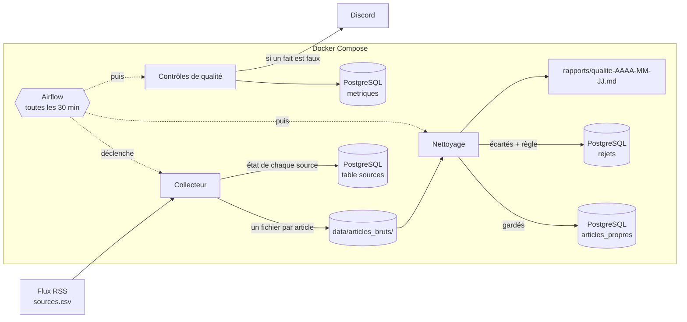

# La gazette

Chaque matin, lire la presse quotidienne régionale (PQR) et nationale (PQN) et publier un
résumé des thèmes abordés : quels sujets, avec quelles sources, et où lire la suite.
On ne garde que **titre, extrait, lien et date** : jamais l'article entier, ni les images,
ni les commentaires.

Projet M2Ops · M2 Data Engineering & IA · Efrei · 2026-2027.

## Où on en est (TD 4)

| TD | Livré |
|---|---|
| 1 · Cadrage | Veille, note de cadrage, schéma d'architecture, `sources.csv` (4 PQN + 4 PQR vérifiées) |
| 2 · Socle | Dépôt et revue par pull request, Docker / Docker Compose, PostgreSQL, CI GitHub |
| 3 · Collecte | Collecte automatique de toutes les sources toutes les 30 min (Airflow), stockage brut sans doublon, reprise après erreur, mise en sommeil des sources en échec |
| 4 · Nettoyage | Normalisation, règles d'exclusion identifiées, tables `articles_propres` et `rejets`, rapport de qualité, contrôles de qualité après chaque passe, métriques et alerte Discord |

À venir : thèmes (TD 5-6), édition de 7 h (TD 7), supervision (TD 8), infrastructure
consolidée (TD 9).

## Comment ça marche



À chaque passe, le collecteur :
1. applique les migrations et recopie `sources.csv` dans la table `sources` ;
2. lit chaque source **active**, l'une après l'autre, avec un GET conditionnel
   (`ETag` / `Last-Modified` : un flux inchangé répond 304 et n'est pas retéléchargé) ;
3. écrit chaque nouvel article dans `data/articles_bruts/<source>/<id>.json`, où `id` est
   calculé à partir de `(source, lien)` : un article déjà présent n'est jamais réécrit ;
4. note pour chaque source sa dernière réussite ou son échec, et écrit une ligne de journal
   JSON par source, puis les compteurs de la passe.

En cas d'erreur : **transitoire** (503, 429, 5xx, timeout, réseau) → nouvel essai après
2 s, 10 s puis 30 s ; **permanente** (404, 403, flux illisible) → pas de nouvel essai.
Au **3e échec de suite**, la source est **mise en sommeil** et n'est plus appelée.

Ensuite, **le nettoyage** (tâche `nettoyer` du DAG, ou `python -m gazette.nettoyage`) :
1. repère les articles du brut pas encore traités (leur `id` n'est ni dans `articles_propres`
   ni dans `rejets`) ;
2. les **normalise** (HTML retiré, entités, espaces, encodage, dates en UTC, extrait borné) ;
3. applique les **règles d'exclusion** (`src/gazette/regles.py`, identifiants `R01_…` à `R15_…`,
   documentées dans `docs/qualite.md`) et écarte les doublons d'une même source ;
4. enregistre les gardés dans `articles_propres` et les autres dans `rejets` (avec la règle),
   sans jamais copier `payload` ni l'auteur ;
5. régénère le **rapport de qualité du jour** dans `rapports/` (par règle, par source, règles
   à surveiller).

Enfin, **les contrôles de qualité** (tâche `controler`, qui tourne même si la collecte a échoué) :
1. vérifient huit **faits** sur les vraies données (aucune date future, aucun titre vide, taux de
   rejet d'une source raisonnable, aucune source en sommeil, collecte récente…) ;
2. enregistrent les **métriques** de la passe (articles reçus, gardés, rejetés, par règle et par
   source…) dans la table `metriques`, qui garde l'historique ;
3. **alertent sur Discord** quand un fait devient faux (puis rappel après 24 h, puis message de
   rétablissement), sans répéter le même message toutes les 30 minutes.

Détail des contrôles, des métriques et de l'alerte : [docs/controles.md](docs/controles.md).
Détail des champs, des tables et du journal : [docs/donnees.md](docs/donnees.md).

## Prérequis

- Git
- Docker et Docker Compose, **lancés**
- Sous Windows : Git Bash (ou WSL) pour les scripts `bin/`

## Démarrer

```bash
git clone https://github.com/emiliehhd/M2Ops_Gazette.git && cd M2Ops_Gazette
bin/dev
```

`bin/dev` crée `.env` (depuis `.env.example`), construit l'image, démarre PostgreSQL et
lance **une passe de collecte**. Résultat attendu : une ligne `source_collectee` par source,
une ligne `passe_terminee`, et des fichiers dans `data/articles_bruts/`.

> **Linux :** ne lancez pas ces commandes avec `sudo`. Sinon `data/` appartient à root et la
> collecte échoue avec `PermissionError`. Correctif : `sudo chown $USER: data`.

## Faire tourner la collecte automatiquement (Airflow)

Pour recevoir les alertes, renseigner d'abord `DISCORD_WEBHOOK_URL` dans `.env` (voir
[docs/controles.md](docs/controles.md)). Sans elle, tout fonctionne, seule l'alerte manque.

```bash
docker compose --profile orchestration up -d --build
```

1. Ouvrir **http://localhost:8080** (pas de mot de passe ; accessible seulement depuis la
   machine). Si le port 8080 est déjà pris, ajouter `AIRFLOW_PORT=8081` dans `.env` et
   relancer la commande.
2. Activer le DAG **`collecte_flux`** avec son interrupteur : il passe à :00 et :30,
   heure de Paris.
3. « Déclencher » lance une passe tout de suite. Le détail d'une passe : tâches `collecter`
   (une ligne de journal par source), `nettoyer` (une ligne `passe_nettoyage_terminee`) puis
   `controler` (résultat de chaque contrôle), onglets **Journaux** et **XCom** (compteurs).

Pour qu'elle continue de tourner : machine allumée, Docker lancé, pas de
`docker compose down`. Les passes manquées ne sont pas rattrapées (`catchup=False`).
Arrêter : `docker compose --profile orchestration down`.

> Après avoir modifié le code Python (`src/`), relancer avec `--build` : l'image Airflow
> contient notre paquet. Les fichiers de `dags/` sont lus tels quels.

## Commandes utiles

```bash
# État de chaque source : active ou en sommeil, échecs, dernière réussite
docker compose run --rm app python -m gazette.db etat

# Réveiller une source en sommeil, une fois la cause corrigée
docker compose run --rm app python -m gazette.db reveiller "Nom de la source"

# Nombre d'articles collectés par source
for d in data/articles_bruts/*/; do echo "$(ls "$d" | wc -l)  $(basename "$d")"; done

# Collecter une seule source, sans mettre la table à jour
docker compose run --rm app python -m gazette.collecte "Le Monde"

# Nettoyer à la main ce qui n'est pas encore traité (et régénérer le rapport du jour)
docker compose run --rm app python -m gazette.nettoyage

# Articles rejetés, par règle (valeurs par défaut de .env.example)
docker compose exec db psql -U gazette -d gazette -c "SELECT regle, count(*) FROM rejets GROUP BY regle ORDER BY 2 DESC"
```

Le rapport du jour est dans `rapports/qualite-AAAA-MM-JJ.md`.

```bash
# Lancer les contrôles de qualité maintenant
docker compose run --rm app python -m gazette.controles

# Vérifier que le canal Discord fonctionne
docker compose run --rm app python -m gazette.controles test-alerte
```

> Après avoir modifié le code ou `sources.csv`, reconstruire l'image avant un
> `docker compose run` : `docker compose build app`. (`bin/dev` le fait tout seul ;
> Airflow lit `sources.csv` directement, sans reconstruction.)

## Tester

```bash
bin/test
```

Résultat attendu : **`189 passed`**. Les tests démarrent un PostgreSQL de test (schéma
séparé : vos données ne sont pas touchées) et un faux éditeur HTTP local (pas besoin
d'Internet). Ils couvrent notamment :
- **deux passages, zéro doublon** ;
- **source en panne** : le faux serveur répond 503 → nouveaux essais, puis sommeil au
  3e échec, puis plus aucun appel ;
- flux inchangé (304), source en erreur qui n'arrête pas les autres, 404 sans nouvel essai,
  migrations appliquées une seule fois ;
- **normalisation** (une fonction pure, un test par fonction) et **règles d'exclusion**
  (chaque règle, plus des cas à ne pas écarter) ;
- **nettoyage** : deux passages sans doublon, traçabilité d'un article propre à son brut,
  ni auteur ni `payload` dans les tables, fichier illisible sans arrêt de la passe, rapport
  du jour ;
- **contrôles** : chaque fait faux est détecté, l'alerte sonne une fois puis se rappelle après
  24 h puis annonce le rétablissement, Discord en panne (faux serveur local, rien n'est envoyé
  à un vrai canal), l'adresse du webhook ne fuite jamais.

Sans Docker (facultatif) : `pip install -e ".[dev]"` puis `pytest`. Les tests de base de
données sont alors ignorés, sauf si `GAZETTE_TEST_DSN` pointe vers un PostgreSQL.

## Intégration continue

À chaque pull request et à chaque push sur `main` : lint (`ruff`), tests (avec un
PostgreSQL), construction de l'image ; publication sur `ghcr.io` depuis `main` uniquement.
Détails : [docs/ci-cd.md](docs/ci-cd.md).

## Sources

Liste complète, adresses et conditions d'utilisation : [`sources.csv`](sources.csv).

| PQN | PQR |
|---|---|
| Le Monde | Ouest-France |
| Le Figaro | Sud Ouest |
| Libération | La Dépêche du Midi |
| La Croix | Le Progrès |

**La Voix du Nord** refuse les robots (HTTP 403) depuis le 22/10/2026 : elle est en sommeil
et a été remplacée par **Le Progrès**. Écartées après vérification : Les Échos (pas de flux
général), Le Parisien (flux sans date ni extrait), Le Télégramme (403).

## Choix techniques

| Besoin | Choix | Écartés, et pourquoi |
|---|---|---|
| Lire la presse | Flux RSS, `feedparser` | Sitemaps (pas d'extrait), scraping (interdit, fragile) |
| Planifier | Airflow | `cron` (ni reprise ni historique), GitHub Actions `schedule` (heure non garantie, fait pour la CI) |
| Stockage brut | Un fichier JSON par article | Base de données seule (on perd le brut tel que reçu) |
| Clé anti-doublon | `(source, lien)` | `guid` (pas fiable partout) |
| Migrations | Fichiers SQL versionnés (`migrations/`) | Alembic (lourd pour une table), Flyway (Java, un conteneur de plus) |
| Stockage propre | PostgreSQL (`articles_propres`, `rejets`) | Tout dans la même table (on perdrait la règle de rejet) |
| Règles de qualité | Fonctions Python lisibles, un identifiant par règle | Un modèle (hors cadrage, non reproductible) |
| Contrôles de données | Requêtes SQL et Python écrites à la main | Great Expectations, Soda (trop lourds pour huit faits simples) |
| Alerte | Webhook Discord, un message par panne (rappel après 24 h) | Un message toutes les 30 min (bruit), mail (personne ne le lit à temps) |

## Organisation du dépôt

| Chemin | Contenu |
|---|---|
| `src/gazette/collecte.py` | Lecture de `sources.csv`, parseur, écriture des articles bruts |
| `src/gazette/collecteur.py` | Passe multi-sources : GET conditionnel, reprise, sommeil, journal |
| `src/gazette/db.py` | Migrations, table `sources`, commandes `etat` et `reveiller` |
| `src/gazette/normalisation.py` | Une fonction pure par transformation (HTML, entités, espaces, encodage, dates, extrait) |
| `src/gazette/regles.py` | Règles d'exclusion identifiées et dédoublonnage par source |
| `src/gazette/nettoyage.py` | Du brut aux tables `articles_propres` et `rejets` |
| `src/gazette/rapport.py` | Rapport de qualité (par règle, par source, règles à surveiller) |
| `src/gazette/metriques.py` | Les chiffres de chaque passe, enregistrés dans la table `metriques` |
| `src/gazette/controles.py` | Contrôles de qualité, état des pannes, alerte Discord |
| `migrations/` | Migrations SQL versionnées, appliquées une seule fois |
| `dags/` | Le DAG Airflow `collecte_flux` (collecter, nettoyer, contrôler) |
| `infra/airflow/` | L'image Airflow avec notre paquet |
| `tests/` | Tests, faux éditeur HTTP, flux enregistrés (`fixtures/`) |
| `docs/` | Cadrage, CI/CD, dictionnaire de données, règles de qualité, contrôles et alerte |
| `rapports/` | Rapports de qualité quotidiens (non versionnés) |
| `sources.csv` | Les sources, leur adresse, leurs conditions |
| `Dockerfile`, `docker-compose.yml` | L'environnement, décrit en code |
| `bin/dev`, `bin/test` | Lancer, tester |
| `.github/workflows/ci.yml` | L'intégration continue |

## Limites connues

- Une passe toutes les 30 min peut manquer des articles d'Ouest-France, dont le flux ne
  garde que ~10 articles (renouvelés en 30 min à 1 h).
- Tant que l'infrastructure n'est pas fournie (TD 4 ou 6), la collecte ne tourne que si la
  machine qui héberge Airflow est allumée.
- Les conditions de plusieurs éditeurs interdisent la rediffusion, voire l'extraction :
  question posée à l'enseignant.
- Le rapport de qualité du premier jour compte tout l'arriéré du brut, traité en une fois.
- Si la machine ou Airflow s'arrête, rien ne tourne, alerte comprise : un battement de cœur
  externe (Healthchecks) est prévu avec la supervision.
- Le brut est en JSON, comme demandé au TD 3 ; un format en colonnes (Parquet) est envisagé
  pour la suite.

## Contribuer

Lisez [CONTRIBUTING.md](CONTRIBUTING.md) : une branche par sujet, pull request relue,
CI verte avant fusion.
