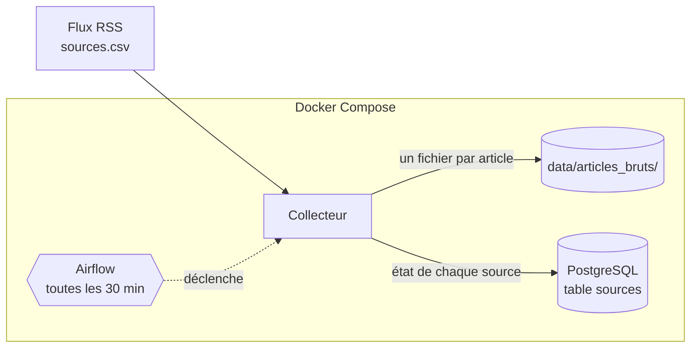

# La gazette

Chaque matin, lire la presse quotidienne régionale (PQR) et nationale (PQN) et publier un
résumé des thèmes abordés : quels sujets, avec quelles sources, et où lire la suite.
On ne garde que **titre, extrait, lien et date** : jamais l'article entier, ni les images,
ni les commentaires.

Projet M2Ops · M2 Data Engineering & IA · Efrei · 2026-2027.

## Où on en est (TD 3)

| TD | Livré |
|---|---|
| 1 · Cadrage | Veille, note de cadrage, schéma d'architecture, `sources.csv` (4 PQN + 4 PQR vérifiées) |
| 2 · Socle | Dépôt et revue par pull request, Docker / Docker Compose, PostgreSQL, CI GitHub |
| 3 · Collecte | Collecte automatique de toutes les sources toutes les 30 min (Airflow), stockage brut sans doublon, reprise après erreur, mise en sommeil des sources en échec |

À venir : nettoyage et contrôle qualité (TD 4), thèmes (TD 5-6), édition de 7 h (TD 7),
supervision (TD 8), infrastructure consolidée (TD 9).

## Comment ça marche



À chaque passe, le collecteur :
1. applique les migrations et recopie `sources.csv` dans la table `sources` ;
2. lit chaque source **active**, l'une après l'autre, avec un GET conditionnel
   (`ETag` / `Last-Modified` : un flux inchangé répond 304 et n'est pas retéléchargé) ;
3. écrit chaque nouvel article dans `data/articles_bruts/<source>/<id>.json`, où `id` est
   calculé à partir de `(source, lien)` : un article déjà présent n'est jamais réécrit ;
4. note pour chaque source sa dernière réussite ou son échec, et écrit une ligne de journal
   JSON par source, puis les compteurs de la passe.

En cas d'erreur : **transitoire** (503, 429, 5xx, timeout, réseau) → nouvel essai après
2 s, 10 s puis 30 s ; **permanente** (404, 403, flux illisible) → pas de nouvel essai.
Au **3e échec de suite**, la source est **mise en sommeil** et n'est plus appelée.

Détail des champs, des tables et du journal : [docs/donnees.md](docs/donnees.md).

## Prérequis

- Git
- Docker et Docker Compose, **lancés**
- Sous Windows : Git Bash (ou WSL) pour les scripts `bin/`

## Démarrer

```bash
git clone https://github.com/emiliehhd/M2Ops_Gazette.git && cd M2Ops_Gazette
bin/dev
```

`bin/dev` crée `.env` (depuis `.env.example`), construit l'image, démarre PostgreSQL et
lance **une passe de collecte**. Résultat attendu : une ligne `source_collectee` par source,
une ligne `passe_terminee`, et des fichiers dans `data/articles_bruts/`.

> **Linux :** ne lancez pas ces commandes avec `sudo`. Sinon `data/` appartient à root et la
> collecte échoue avec `PermissionError`. Correctif : `sudo chown $USER: data`.

## Faire tourner la collecte automatiquement (Airflow)

```bash
docker compose --profile orchestration up -d --build
```

1. Ouvrir **http://localhost:8080** (pas de mot de passe ; accessible seulement depuis la
   machine). Si le port 8080 est déjà pris, ajouter `AIRFLOW_PORT=8081` dans `.env` et
   relancer la commande.
2. Activer le DAG **`collecte_flux`** avec son interrupteur : il passe à :00 et :30,
   heure de Paris.
3. « Déclencher » lance une passe tout de suite. Le détail d'une passe : tâche `collecter`,
   onglets **Journaux** (une ligne par source) et **XCom** (compteurs de la passe).

Pour qu'elle continue de tourner : machine allumée, Docker lancé, pas de
`docker compose down`. Les passes manquées ne sont pas rattrapées (`catchup=False`).
Arrêter : `docker compose --profile orchestration down`.

## Commandes utiles

```bash
# État de chaque source : active ou en sommeil, échecs, dernière réussite
docker compose run --rm app python -m gazette.db etat

# Réveiller une source en sommeil, une fois la cause corrigée
docker compose run --rm app python -m gazette.db reveiller "Nom de la source"

# Nombre d'articles collectés par source
for d in data/articles_bruts/*/; do echo "$(ls "$d" | wc -l)  $(basename "$d")"; done

# Collecter une seule source, sans mettre la table à jour
docker compose run --rm app python -m gazette.collecte "Le Monde"
```

> Après avoir modifié le code ou `sources.csv`, reconstruire l'image avant un
> `docker compose run` : `docker compose build app`. (`bin/dev` le fait tout seul ;
> Airflow lit `sources.csv` directement, sans reconstruction.)

## Tester

```bash
bin/test
```

Résultat attendu : **`13 passed`**. Les tests démarrent un PostgreSQL de test (schéma
séparé : vos données ne sont pas touchées) et un faux éditeur HTTP local (pas besoin
d'Internet). Ils couvrent notamment :
- **deux passages, zéro doublon** ;
- **source en panne** : le faux serveur répond 503 → nouveaux essais, puis sommeil au
  3e échec, puis plus aucun appel ;
- flux inchangé (304), source en erreur qui n'arrête pas les autres, 404 sans nouvel essai,
  migrations appliquées une seule fois.

Sans Docker (facultatif) : `pip install -e ".[dev]"` puis `pytest`. Les tests de base de
données sont alors ignorés, sauf si `GAZETTE_TEST_DSN` pointe vers un PostgreSQL.

## Intégration continue

À chaque pull request et à chaque push sur `main` : lint (`ruff`), tests (avec un
PostgreSQL), construction de l'image ; publication sur `ghcr.io` depuis `main` uniquement.
Détails : [docs/ci-cd.md](docs/ci-cd.md).

## Sources

Liste complète, adresses et conditions d'utilisation : [`sources.csv`](sources.csv).

| PQN | PQR |
|---|---|
| Le Monde | Ouest-France |
| Le Figaro | Sud Ouest |
| Libération | La Dépêche du Midi |
| La Croix | Le Progrès |

**La Voix du Nord** refuse les robots (HTTP 403) depuis le 22/10/2026 : elle est en sommeil
et a été remplacée par **Le Progrès**. Écartées après vérification : Les Échos (pas de flux
général), Le Parisien (flux sans date ni extrait), Le Télégramme (403).

## Choix techniques

| Besoin | Choix | Écartés, et pourquoi |
|---|---|---|
| Lire la presse | Flux RSS, `feedparser` | Sitemaps (pas d'extrait), scraping (interdit, fragile) |
| Planifier | Airflow | `cron` (ni reprise ni historique), GitHub Actions `schedule` (heure non garantie, fait pour la CI) |
| Stockage brut | Un fichier JSON par article | Base de données seule (on perd le brut tel que reçu) |
| Clé anti-doublon | `(source, lien)` | `guid` (pas fiable partout) |
| Migrations | Fichiers SQL versionnés (`migrations/`) | Alembic (lourd pour une table), Flyway (Java, un conteneur de plus) |

## Organisation du dépôt

| Chemin | Contenu |
|---|---|
| `src/gazette/collecte.py` | Lecture de `sources.csv`, parseur, écriture des articles bruts |
| `src/gazette/collecteur.py` | Passe multi-sources : GET conditionnel, reprise, sommeil, journal |
| `src/gazette/db.py` | Migrations, table `sources`, commandes `etat` et `reveiller` |
| `migrations/` | Migrations SQL versionnées, appliquées une seule fois |
| `dags/` | Le DAG Airflow `collecte_flux` |
| `infra/airflow/` | L'image Airflow avec notre paquet |
| `tests/` | Tests, faux éditeur HTTP, flux enregistrés (`fixtures/`) |
| `docs/` | Cadrage, CI/CD, dictionnaire de données |
| `sources.csv` | Les sources, leur adresse, leurs conditions |
| `Dockerfile`, `docker-compose.yml` | L'environnement, décrit en code |
| `bin/dev`, `bin/test` | Lancer, tester |
| `.github/workflows/ci.yml` | L'intégration continue |

## Limites connues

- Une passe toutes les 30 min peut manquer des articles d'Ouest-France, dont le flux ne
  garde que ~10 articles (renouvelés en 30 min à 1 h).
- Tant que l'infrastructure n'est pas fournie (TD 4 ou 6), la collecte ne tourne que si la
  machine qui héberge Airflow est allumée.
- Les conditions de plusieurs éditeurs interdisent la rediffusion, voire l'extraction :
  question posée à l'enseignant.
- Le brut est en JSON, comme demandé au TD 3 ; un format en colonnes (Parquet) est envisagé
  pour la suite.

## Contribuer

Lisez [CONTRIBUTING.md](CONTRIBUTING.md) : une branche par sujet, pull request relue,
CI verte avant fusion.
